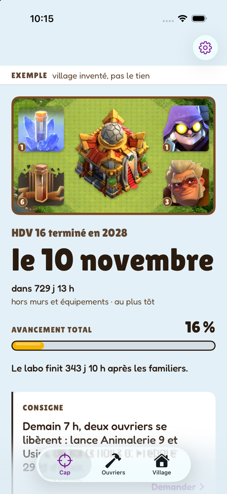
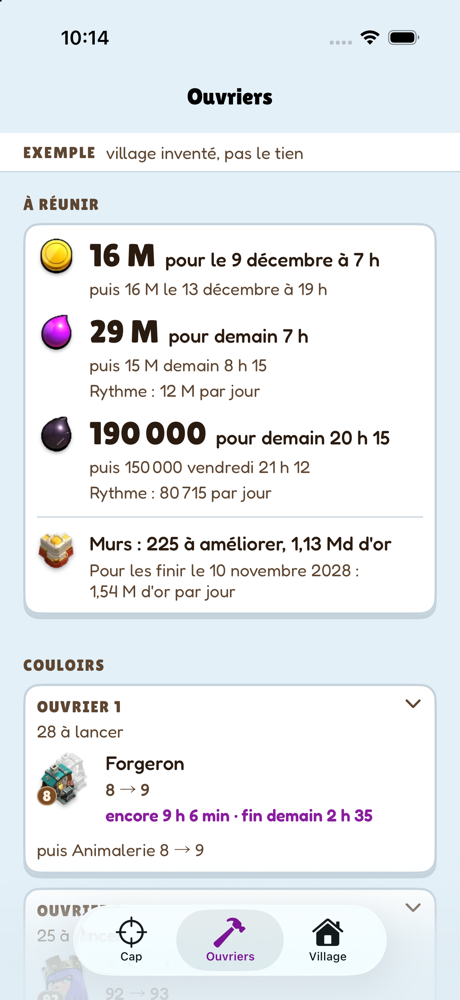

# Village Planner : planificateur d'améliorations pour Clash of Clans

<p align="center"></p>


App iPhone gratuite et non officielle : elle suit l'avancement de ton village de Clash of Clans et planifie tes améliorations.

- Tu copies l'export de ton village depuis le jeu, tu le colles dans l'app.
- Elle calcule ton avancement à ton hôtel de ville, au total et par catégorie.
- Elle propose l'ordre des améliorations pour chaque ouvrier, le labo et la maison des familiers.
- Elle date chaque amélioration et dit combien d'or, d'élixir et d'élixir noir réunir, pour quand.
- Un conseiller explique le plan en quelques phrases ; les chiffres viennent toujours du moteur de calcul.

<p align="center">
  
  &nbsp;
  
</p>

Captures : village d'exemple inventé.

## Installer

Sans compte payant, avec un Mac et Xcode : suis [docs/installation.md](docs/installation.md).

## Faire l'export dans le jeu

Dans le jeu : ton profil, Réglages > Plus de réglages > Data Export > Copier. Reviens dans l'app et touche Coller. L'export reste sur ton iPhone.

## Le conseiller (facultatif)

Il demande une clé de l'API Anthropic, rangée dans le Trousseau de l'iPhone, avec un budget que tu fixes. Sans clé, tout le reste marche ; avec elle, il explique le plan en quelques phrases (les chiffres viennent du moteur de calcul).

## Le compte de jeu (facultatif)

Une clé de l'API officielle de Supercell, passée par le relais RoyaleAPI, ajoute ton profil de joueur (trophées, ligue, héros équipés). Crée une clé dédiée : voir [docs/cle-api-supercell.md](docs/cle-api-supercell.md).

## Compiler

Il faut Xcode 26.6 ou plus récent (iOS 26 au minimum sur l'iPhone). Aucune dépendance tierce.

```sh
# Tests de la logique, sans simulateur
swift test --package-path Packages/VillagePlannerKit

# Tests de vitesse (50, 100, 200 ms), à part et sans parallélisme
VILLAGE_PLANNER_VITESSE=1 swift test --package-path Packages/VillagePlannerKit --filter Vitesse --no-parallel

# Compilation de l'app pour le simulateur
xcodebuild -project VillagePlanner.xcodeproj -scheme VillagePlanner -destination 'generic/platform=iOS Simulator' build
```

Pour installer sur un iPhone, copie `Config/Signature.exemple.xcconfig` en `Config/Signature.local.xcconfig` (ignoré par git) et mets-y ton identifiant d'équipe Apple.

## Données

Les données de référence du jeu (coûts, durées, niveaux maximums) sont tirées de [ClashKingInc/ClashKingAssets](https://github.com/ClashKingInc/ClashKingAssets) (GPL-3.0), contrôlées avec [chiefpansancolt/clash-of-clans-data](https://github.com/chiefpansancolt/clash-of-clans-data) (MIT). Le fichier embarqué `reference.json` est produit par `outils maj-reference` (procédure : [docs/mise-a-jour-du-jeu.md](docs/mise-a-jour-du-jeu.md)). L'app ne touche pas au jeu : elle lit seulement l'export que tu copies toi-même.

Les illustrations des bâtiments, pièges, unités, héros, familiers et équipements, et les deux décors de l'écran Cap, sont des images du jeu (propriété de Supercell, montrées sans modification) servies par [ClashKingAssets](https://github.com/ClashKingInc/ClashKingAssets) (assets.clashk.ing), qui demande ce crédit. Elles sont dans `App/Ressources/Illustrations/`, produites par `swift run --package-path Packages/VillagePlannerKit outils maj-images` (seulement les éléments qui comptent dans l'avancement ; rapport des éléments sans image dans `Packages/VillagePlannerKit/.cache/maj-images/rapport.md`).

Polices : [Lilita One](https://fonts.google.com/specimen/Lilita+One) et [Fredoka](https://fonts.google.com/specimen/Fredoka), licence SIL Open Font License 1.1 (textes dans `App/Ressources/Polices/`).

## Mention

This material is unofficial and is not endorsed by Supercell. For more information see Supercell's Fan Content Policy: www.supercell.com/fan-content-policy.

Ce contenu n'est pas officiel et n'est pas approuvé par Supercell. Pour en savoir plus, voir la politique de contenu des fans de Supercell : www.supercell.com/fan-content-policy.

## Licence

GPL-3.0, voir [LICENSE](LICENSE).
